<div align="center">




</div>

<br>

**The Node Wanderer** is a small 2D platformer for learning linked lists, written in C++17 with Raylib 5.5.
Every platform is a real `Node` allocated with `new` and owned by a linked list.
The traveler moves along the list's links, and the field journal (<kbd>Tab</kbd>) reads those same links.

This is the Tutorial Stage: four regions, one list each.



## The journey

Each region is a separate list. Its exit gate starts you at the head of the next one.

<table>
<tr>
<td width="50%"></td>
<td width="50%"></td>
</tr>
<tr>
<td valign="top"><b>1. The First Connection</b> · singly linked list<br>A forest. Follow <code>next</code> from the head to the tail. Going backward fails, because no <code>previous</code> link is stored.</td>
<td valign="top"><b>2. The Forgotten Return</b> · doubly linked list<br>Flooded ruins. Take the key from N4 (Key Shrine), carry its light back to N2 (Old Hall) through <code>previous</code> to light the brazier, then continue to the tail.</td>
</tr>
<tr>
<td width="50%"></td>
<td width="50%"></td>
</tr>
<tr>
<td valign="top"><b>3. The Endless Garden</b> · circular singly linked list<br>A moonlit garden. The hollow in the tail's root is <code>tail->next</code>: walk into it and a great root carries you back to the head. Go around once; the walk stops when <code>current == start</code>, or at a safety limit of 12 steps.</td>
<td valign="top"><b>4. The Edge of Nothing</b> · NULL pointer safety<br>Cliffs above an abyss. N3's <code>next</code> is <code>nullptr</code>, so past its edge there is only an amber glow and snapped ropes. Open the journal and press <kbd>E</kbd> on N3: the game checks the pointer, calls <code>append()</code>, and the bridge N4 assembles from the new node.</td>
</tr>
</table>

## How it teaches

- **Only real links are solid (Traversal Rule A).** You can stand on the current node and on the nodes its links point to: `next` in every list, and also `previous` in the doubly linked list. Every other ledge fades into mist and cannot hold you. If you fall, you return to your last checkpoint.
- **Light shows the links.** Warm light rises from the ledge that `current->next` points to. In Region 2, cool light falls on the ledge that `current->previous` points to. A small light near the traveler drifts toward the link to follow.
- **Every move shows its code.** After each step the corner shows the line that ran, for example `current = current->next;   N2 -> N3`.
- **The field journal reads the real list.** Press <kbd>Tab</kbd> to see the node you are on, where its links point, and a walk from the head that ends at `NULL` or back at the head.
- **Color is never the only cue.** The current node is always a gold diamond, and `NULL` always has a stop mark.
- **Memory is checked.** `append()` allocates each node with `new` and `clear()` deletes it. When the game exits, the console prints `Nodes still allocated at shutdown: 0`.

<p align="center">

</p>


## Play it

The build uses MSVC, CMake, and Ninja on Windows.
Open a "Developer PowerShell for VS" (or run `VsDevCmd.bat`), then:

```powershell
cmake -S . -B build -G Ninja -DCMAKE_BUILD_TYPE=Debug
cmake --build build
.\build\NodeWanderer.exe
```

The first configure step downloads Raylib, so it needs an internet connection.

| Action | Keys |
| --- | --- |
| Move | <kbd>A</kbd> <kbd>D</kbd> or <kbd>←</kbd> <kbd>→</kbd> |
| Jump | <kbd>Space</kbd> |
| Interact, continue a message | <kbd>E</kbd> or <kbd>Enter</kbd> |
| Open or close the field journal | <kbd>Tab</kbd> |
| Pause and resume | <kbd>Esc</kbd> (<kbd>Q</kbd> quits while paused) |
| On the final summary | <kbd>R</kbd> plays again, <kbd>Q</kbd> or <kbd>Esc</kbd> exits |


## Under the hood

There is one structure for platforms. The game draws, collides with, and inspects these exact objects (`src/Node.h`):

```cpp
struct Node {
    int id;                   // stable ID shown in the game (N1, N2, ...)
    const char* label;        // short readable name
    Vector2 platformPosition; // world coordinates of the platform's top-left corner
    float platformWidth;
    Node* next;               // the following node, or nullptr
    Node* previous;           // used only by the doubly linked list; nullptr otherwise
};
```

Collision and drawing both ask the same function which platforms are solid, so what you see is what the links allow (`src/World.cpp`):

```cpp
bool isPlatformSolid(const Node* current, const Node* candidate, ListKind kind) {
    if (current == nullptr || candidate == nullptr) {
        return false;
    }
    if (candidate == current) {
        return true; // you can always stand on the node you are at
    }
    if (current->next != nullptr && candidate == current->next) {
        return true; // every list kind allows following next
    }
    if (kind == ListKind::Doubly && current->previous != nullptr && candidate == current->previous) {
        return true; // only a doubly linked list allows following previous
    }
    return false;
}
```

### Where to find things

| What | File |
| --- | --- |
| `Node` definition | `src/Node.h` |
| List operations (`append`, `clear`) | `src/SinglyLinkedList.cpp`, `src/DoublyLinkedList.cpp`, `src/CircularSinglyLinkedList.cpp` |
| Region setup, link checks, Traversal Rule A (`isPlatformSolid`) | `src/World.cpp` |
| Player-to-node traversal (`resolveLandings`, `followLink`), objectives, recovery, transitions | `src/Game.cpp` |
| Keyboard input, read once per frame | `src/Input.h` |
| Player movement and the traveler pixel sprite | `src/Player.cpp` |
| How a frame of the world is drawn, and the wisp hint | `src/GameScene.cpp` |
| HUD, field journal (inspector), notes, pause, summary | `src/GameUi.cpp` |
| Shared art helpers: platform outlines, materials, mist, link glows, lanterns | `src/ArtCommon.h`, `src/ArtCommon.cpp` |
| Region art (platforms from nodes, plus decoration) | `src/ForestArt.cpp`, `src/RuinsArt.cpp`, `src/GardenArt.cpp`, `src/EdgeArt.cpp` |
| Particles (dust, leaves, sparks) | `src/Effects.cpp` |
| Interface colors | `src/Theme.h` |
| The animated art in this README, and the script that draws it | `docs/readme/` |

## The art

The whole world is drawn into a 640x360 pixel canvas that is scaled up 2x, so the scenery, the platforms, the traveler, and the effects share one pixel size. All art is drawn in code with Raylib shapes; there are no image assets.

- **Platforms are natural forms that fit each place:** forest cliffs, a mossy boulder, a fallen log; ruined masonry, a broken arch, a column capital, a shrine, old stairs; a garden terrace, a moon-cap mushroom, a planter, a root knot; rock cliffs and the rebuilt rope bridge. Each one is drawn only from its node's position and width, and its look is chosen from the node's ID. The top row of every platform matches its collision exactly. There are no node boxes, labels, or pointer arrows in the world.
- **Each region has its own palette and light:** golden forest afternoon, blue-hour ruins with braziers, a violet night garden with a glowing spring, and cold cliffs before dawn. Fixing the NULL link in Region 4 brings the dawn.
- **Depth:** every region has far, middle, and near layers, mist between them, and a soft vignette. Near layers stay below and beside the route.
- **The traveler:** a 14x24-pixel explorer with a hat, a red scarf, a backpack, and a lantern, with idle breathing, a two-step walk, a jump stretch, falling and landing poses, and a contact shadow.
- **Feedback:** dust when jumping and landing; leaves, chips, or petals when arriving on a new node; sparks when a checkpoint lantern lights; light gathering back into the traveler after a fall; and a fade with the region's name between regions.
- **Interface:** small dark cards in play (the region and objective, the list as marks walked from the head, the last line of pointer code, and the controls), and an explorer's field journal for reading: the inspector, the notes, the pause cover, and the final summary.

The animated pictures in this README are drawn in code as well. `docs/readme/make-art.ps1` paints them pixel by pixel with the game's palettes and the traveler sprite from `src/Player.cpp`, then writes them as SVG with CSS and SMIL animation. Each one loops, and holds still when the system asks for reduced motion. To redraw them after changing the art:

```powershell
powershell -ExecutionPolicy Bypass -File docs/readme/make-art.ps1          # all files
powershell -ExecutionPolicy Bypass -File docs/readme/make-art.ps1 -Only hero,edge
```

<br>

<p align="center">

</p>
