<div align="center">


</div>

<br>

**The Node Wanderer** is a short pixel-art adventure. A traveler with a hat, a red scarf, and a lantern crosses six places: a deep forest, drowned ruins under the moon, a night garden that never ends, the cliffs where the world runs out, a lighthouse in the morning fog, and a harbor in the sun.
Follow the warm light from ledge to ledge, carry a key's light home, walk a garden that loops back on itself, mend a bridge over nothing, build a stair of stones up a lighthouse and take it down again, and cross a harbor on a line of boats.
Each place has its own music and sounds: birds and wind in the trees, drips in the flooded halls, crickets in the night garden, wind across the cliffs until the dawn, surf below the lighthouse, and gulls over the harbor.

It is also a game about linked lists. Each place is built from one list, the ledges, stones, and boats you stand on are its nodes, and you can only step where a link leads. The last two places are a stack and a queue built from linked nodes.
Your field journal (<kbd>Tab</kbd>) shows how it works. The game is written in C++17 with Raylib 5.5.


## The journey

<table>
<tr>
<td width="50%"></td>
<td width="50%"></td>
</tr>
<tr>
<td valign="top"><b>1. The First Connection</b> · singly linked list<br>A deep forest in late golden light. Only the ledge ahead will hold you: follow the warm light up through the trees, over a fallen log, and down to a sunlit arch. There is no way back, because each ledge only knows the one after it.</td>
<td valign="top"><b>2. The Forgotten Return</b> · doubly linked list<br>Flooded halls under a full moon. Climb a ruined tower to the Key Shrine, carry the key's light back down to the Old Hall to wake its brazier, then go on. Here every stone also remembers the one before it.</td>
</tr>
<tr>
<td width="50%"></td>
<td width="50%"></td>
</tr>
<tr>
<td valign="top"><b>3. The Endless Garden</b> · circular singly linked list<br>A luminous night garden around an ancient tree. The last terrace flows back to the first: step into the hollow at the end of the path and a glowing current carries you home. Walk the circle once, and stop when you are back where you began.</td>
<td valign="top"><b>4. The Edge of Nothing</b> · NULL pointer safety<br>Cold cliffs before dawn. Past the last cliff the bridge has fallen, and there is nothing to stand on. Look before you step, then mend the way: the bridge is laid plank by plank, lanterns light along it, and dawn breaks over the peaks.</td>
</tr>
<tr>
<td width="50%"></td>
<td width="50%"></td>
</tr>
<tr>
<td valign="top"><b>5. The Lighthouse Stair</b> · stack<br>A lighthouse on the sea cliffs in morning fog, its stair fallen and its fog bell out of reach. Set stones one on top of another, climb, and ring the bell, then take the stair down. Only the top stone holds, and the last one set is the first to go.</td>
<td valign="top"><b>6. The Patient Harbor</b> · queue<br>A bright harbor below a hill town. Call a boat and it rows in at the end of the line; step from boat to boat, and the one you leave rows away. The boat that came first leaves first, and the line ends at a ship.</td>
</tr>
</table>

## How it teaches

- **You can only stand where a link leads.** The ledge you are on and the ledges its links point to are solid: `next` in every place, and `previous` too in the drowned ruins. On the lighthouse stair, only the top stone holds. Every other ledge sleeps in mist. If you fall, your lantern brings you back to the last checkpoint.
- **Lists that change while you play.** At the edge, `append()` creates the bridge. On the stair, `push()` sets a stone on the top and `pop()` takes the top away. In the harbor, `enqueue()` calls a boat to the rear and `dequeue()` sends the front boat away. Each of these is a real node, created with `new` and deleted when it goes.
- **Light shows the way.** Warm light rises from the ledge that `next` points to, and a stream of motes drifts from the traveler toward it. In the ruins, cool light marks the way back through `previous`. In the garden, the current is the link from the tail back to the head. At the edge, amber light marks the link that is missing. In the harbor, the lamp on the next empty post shows where the next boat will moor.
- **Two voices.** While you explore, the game speaks plainly about where you are and what to do. The first time you use each kind of link, a slip from the journal names it with one line of code, such as `current = current->next;`. Ordinary steps show no code.
- **The field journal reads the real list.** Press <kbd>Tab</kbd> to see the node you are on, where its links point, the whole list walked from its head to `NULL` (or back to the start), and what the place teaches.
- **Each place ends with a question.** Reaching the goal asks a short question in the journal, answers it, and opens the way on.
- **Color is never the only cue.** The current node is always a gold diamond, and `NULL` always has a stop mark.

<p align="center">

</p>


## Play it

The build uses MSVC, CMake, and Ninja on Windows.
Open a "Developer PowerShell for VS" (or run `VsDevCmd.bat`), then:

```powershell
cmake -S . -B build -G Ninja -DCMAKE_BUILD_TYPE=Release
cmake --build build
.\build\NodeWanderer.exe
```

The first configure step downloads Raylib, so it needs an internet connection. Playing needs none.
Raylib, the MSVC runtime, the art, and the shaders are built into `NodeWanderer.exe`, so it needs only Windows itself. The music and sounds are files in `assets/audio`; each build copies that folder beside the exe (`build\assets\audio`).
To make a folder you can share or copy to another PC, install the build:

```powershell
cmake --install build --prefix dist --component game   # dist\NodeWanderer.exe and dist\assets\audio
```

The game looks for `assets/audio` beside the exe first, then in the folder it was started from, so it also runs from the repository. Without the folder, or without a sound device, it plays in silence and says so in the console.
For a debug build, where a failed startup check also stops the program, use `-DCMAKE_BUILD_TYPE=Debug`.

The game opens in a 1280x720 window. <kbd>F11</kbd> or <kbd>Alt</kbd>+<kbd>Enter</kbd> (or the pause screen) switches to exclusive fullscreen at the resolution of the monitor the window is on, and back.

| Action | Keys |
| --- | --- |
| Walk | <kbd>A</kbd> <kbd>D</kbd> or <kbd>←</kbd> <kbd>→</kbd> |
| Jump | <kbd>Space</kbd> |
| Interact (mend the bridge, set a stone, ring the bell, call a boat), turn a note's page | <kbd>E</kbd> or <kbd>Enter</kbd> |
| Take the top stone off (the Lighthouse Stair) | <kbd>S</kbd> or <kbd>↓</kbd> |
| Open or close the field journal | <kbd>Tab</kbd> |
| Pause and resume (the pause screen lists the controls) | <kbd>Esc</kbd> (<kbd>Q</kbd> quits while paused) |
| Sound off or on | <kbd>M</kbd> |
| Fullscreen or window | <kbd>F11</kbd> or <kbd>Alt</kbd>+<kbd>Enter</kbd> |
| Music and sound volume, and the screen mode, on the pause screen | <kbd>W</kbd> <kbd>S</kbd> or <kbd>↑</kbd> <kbd>↓</kbd> choose, <kbd>A</kbd> <kbd>D</kbd> or <kbd>←</kbd> <kbd>→</kbd> change |
| At the journey's end | <kbd>R</kbd> walks again, <kbd>Q</kbd> or <kbd>Esc</kbd> exits |


## Under the hood

Every platform is a `Node` that its region's list allocates with `new`. The game draws, collides with, and inspects these exact objects; there is no second, visual-only set of platforms (`src/Node.h`):

```cpp
struct Node {
    int id;                   // stable ID shown in the journal (N1, N2, ...)
    const char* label;        // short readable name
    Vector2 platformPosition; // world coordinates of the platform's top-left corner
    float platformWidth;
    Node* next;               // the following node, or nullptr
    Node* previous;           // used only by the doubly linked list; nullptr otherwise
};
```

Collision and drawing both ask the same function which platforms are solid, so what you see is what the links allow (`src/World.cpp`):

```cpp
bool isPlatformSolid(const Node* current, const Node* candidate, ListKind kind, const Node* head) {
    if (current == nullptr || candidate == nullptr) {
        return false;
    }
    if (candidate == current) {
        return true; // you can always stand on the node you are at
    }
    if (kind == ListKind::Stack) {
        return candidate == head; // a stack only lets you reach its top (the stones under it wait their turn)
    }
    if (current->next != nullptr && candidate == current->next) {
        return true; // every list kind allows following next
    }
    if (kind == ListKind::Doubly && current->previous != nullptr && candidate == current->previous) {
        return true; // only a doubly linked list allows following previous
    }
    return false;
}
```

- **Landing is traversal.** Landing on a solid platform other than the current one moves `current` along the link that leads there (`followLink` in `src/Game.cpp`). Nothing is ever inferred from screen positions.
- **The places are separate lists.** An exit hands the traveler to the next list's head; the lists are never linked to each other.
- **The garden's stop rule.** The walk around the circular list stops when `current == start`. A limit of 12 steps (`MAX_LOOP_STEPS`) is only a safety fallback in case the start is never reached.
- **The edge's check.** With the journal open, pressing <kbd>E</kbd> on N3 runs `if (current->next == nullptr)` and then `append()`, which creates N4 "Bridge" at N3's edge. The bridge is drawn from that new node, and the list frees it like any other.
- **The stair's stack.** `push()` allocates a stone and links it over the top (`stone->next = top; top = stone;`). `pop()` saves `top->next`, deletes the old top, and makes the saved stone the new top. The floor stone's `next` is NULL, so it cannot be popped. Before `pop()` deletes the stone you stand on, your current node and the checkpoint move to the stone under it.
- **The harbor's queue.** `enqueue()` links a boat after the rear (`rear->next = boat; rear = boat;`) without walking the line. When you step off the front boat, `dequeue()` moves `front` to the next boat and deletes the old one, and sets `rear` to NULL if the queue is empty. The animation of a boat rowing away keeps only its ID and its last rectangle, never a pointer.
- **Startup checks.** The game checks every link of every list, and simulates every jump the route needs with the real movement code. The console reports 12 link checks and 27 jump checks; a failed one is reported there and stops a debug build.
- **Memory is checked.** `append()`, `push()`, and `enqueue()` allocate each node, and `clear()`, `pop()`, or `dequeue()` deletes it exactly once (a circular list breaks its cycle first). Platform art keeps node IDs and positions, never node pointers. When the game exits, the console prints `Nodes still allocated at shutdown: 0 (expected 0)`.

### Where to find things

| What | File |
| --- | --- |
| `Node` definition and the live-node counter | `src/Node.h` |
| List operations (`append`, `push`, `pop`, `enqueue`, `dequeue`, `clear`) | `src/SinglyLinkedList.cpp`, `src/DoublyLinkedList.cpp`, `src/CircularSinglyLinkedList.cpp`, `src/LinkedStack.cpp`, `src/LinkedQueue.cpp` |
| Region setup and layout, link checks, Traversal Rule A (`isPlatformSolid`) | `src/World.cpp` |
| Player-to-node traversal (`resolveLandings`, `followLink`), objectives, recovery, transitions, camera, the jump check | `src/Game.cpp` |
| Keyboard input, read once per frame | `src/Input.h` |
| Movement, the jump simulation, the traveler sprite, and its scarf and lantern | `src/Player.cpp` |
| Composing a frame: layers, platforms, traveler, water, lights, and the final pass | `src/GameScene.cpp` |
| HUD, first-time callouts, field journal, notes, pause and its sound panel, and the ending | `src/GameUi.cpp` |
| Which music, ambience, and effects fit each place and event | `src/GameSound.cpp` |
| The audio module: loading, music streams, effects, fades, volume, and mute | `src/Audio.h`, `src/Audio.cpp` |
| The music and sounds, their credits, and copies of their licenses | `assets/audio/` |
| The script that builds every sound from its sources, and a loudness and loop-seam check | `tools/audio/` |
| Shared art types and helpers: layers, wind, swaying pieces, ledges, link glows, lanterns, the guiding stream | `src/Art.h`, `src/ArtCommon.h`, `src/ArtCommon.cpp` |
| Painting on the CPU: masks, shading toward a light, noise, dithering | `src/Paint.h`, `src/Paint.cpp` |
| Render targets, the light map, and the bloom and color-grade shader | `src/Lighting.h`, `src/Lighting.cpp` |
| The 1280x720 frame, the window, and exclusive fullscreen with crisp scaling | `src/Display.h`, `src/Display.cpp` |
| Each place's art, painted from its list's nodes, plus its live motion | `src/ForestArt.cpp`, `src/RuinsArt.cpp`, `src/GardenArt.cpp`, `src/EdgeArt.cpp`, `src/LighthouseArt.cpp`, `src/HarborArt.cpp` |
| Particles (dust, leaves, sparks, splashes) | `src/Effects.cpp` |
| Interface colors | `src/Theme.h` |
| The animated art in this README, and the script that draws it | `docs/readme/` |

## The art

The world is drawn into a 640x360 pixel canvas that is scaled up 2x, so the scenery, the platforms, the traveler, and the effects share one pixel size. Each frame is laid out at 1280x720 and drawn 1:1 in the window. In fullscreen it fills the monitor at 16:9, with black bars on screens of another shape. There it is drawn 2x or 3x larger off screen and scaled down, which smooths text and shapes while every art pixel stays a sharp square: 3x3 screen pixels at 1920x1080, 4x4 at 2560x1440, and 6x6 at 3840x2160. Everything is original and made in code; there are no image files.

- **Painted when a place loads.** Each place's sky, far and near scenery, and every platform are painted pixel by pixel on the CPU when the traveler arrives (`src/Paint.cpp` and the six region files): shapes are shaded toward the light, textured with noise, and blended with dithered gradients, then kept as textures. Moving parts are drawn live every frame: water, fire, foliage in the wind, the current, the bridge, the stones and the boats, the gates, and particles.
- **Light.** A light map darkens everything away from light and lights the scene from above; lanterns, braziers, the moon, and the sun each glow; and a final shader pass adds gentle bloom, a color grade for each place, and a vignette. The shaders are embedded in the source. If they cannot be compiled, the game still runs without the final pass.
- **Six places, six moods.** A deep forest in late golden light, with a giant old tree, roots, mossy stone, light shafts, and drifting motes. Flooded ruins under a full moon, with broken arches, stone halls, braziers, and still water that reflects everything above it. A violet night garden around an ancient tree, with a glowing spring and the current that flows back under its roots. Cold cliffs before dawn above a deep ravine, with a snapped bridge, wind, and amber light rising from the gap. A lighthouse on the sea cliffs in morning fog, with surf on the rocks, gulls, and a fog bell on an iron arm. A bright harbor below a hill town, with a breakwater and its light, boats in a line on clear water, and a ship at the end of the line.
- **Platforms belong to their place:** mossy banks, boulders, and a fallen log; ruined halls, a colonnade, a shrine, and old steps; a garden terrace, a giant moon-cap mushroom, a flower bed, and a root hollow; cliff shelves and the rebuilt rope bridge; stones that slide out of the lighthouse wall; rowing boats and a ship. Each one is painted from its node's position and width, and its top matches its collision exactly. There are no node boxes, labels, or pointer arrows in the world.
- **Motion with purpose.** Gusts of wind roll across canopies, grass, and banners; water ripples under the ruins and throws back the firelight; petals ride the garden's current; when the bridge is mended, the wind drops, lanterns light along it, birds take off, and dawn breaks; fog drifts past the lighthouse, and its bell swings when it rings; boats row in to the end of the line and away from its front.
- **The traveler** is a 14x24-pixel explorer with a hat, a red scarf, a backpack, and a lantern. They breathe when idle, walk in two steps, stretch into a jump, and bend their knees on landing. The scarf is a small chain of points that trails behind, streams when walking or in a gust, and ripples; the lantern swings like a pendulum when the traveler starts and stops.
- **Feedback:** dust at each footstep, jump, and landing; leaves, stone chips, or petals on arriving at a new ledge; a splash in the ruins' water; sparks when a checkpoint lantern lights; light gathering back into the traveler after a fall; and between places, a dark moment that names the place ahead before it fades in.
- **Interface:** in play, a small card with the place and what to do, and a hint for the journal and the pause screen; the controls appear at the start of the journey. Reading happens in an explorer's field journal: the journal itself, its notes, the pause cover, and the last spread at the journey's end.

## The sound

The music is by [Scott Buckley](https://www.scottbuckley.com.au) and is used under the [Creative Commons Attribution 4.0 license](https://creativecommons.org/licenses/by/4.0/). Six of his pieces were cut into seamless loops:

- **The First Connection:** 'Cobalt' by Scott Buckley - released under CC-BY 4.0. www.scottbuckley.com.au
- **The Forgotten Return:** 'Hiraeth' by Scott Buckley - released under CC-BY 4.0. www.scottbuckley.com.au
- **The Endless Garden:** 'Reverie' by Scott Buckley - released under CC-BY 4.0. www.scottbuckley.com.au
- **The Edge of Nothing:** 'Cobalt' (the version without piano) by Scott Buckley - released under CC-BY 4.0. www.scottbuckley.com.au
- **The Lighthouse Stair:** 'Solace' by Scott Buckley - released under CC-BY 4.0. www.scottbuckley.com.au
- **The Patient Harbor:** 'Home Was You' by Scott Buckley - released under CC-BY 4.0. www.scottbuckley.com.au
- **Dawn, and the journey's end:** 'Hymn To The Dawn' by Scott Buckley - released under CC-BY 4.0. www.scottbuckley.com.au

The ambience and effects are in the public domain (CC0): field recordings from [Freesound](https://freesound.org) (forest birds, cave drips, still water, a small fire, crickets, wind, surf below a cliff, a harbor, paddles, gulls, and more), footsteps, knocks, and the journal's paper and leather from [Kenney](https://kenney.nl)'s audio packs, and harp, chime, vibraphone, and bell samples from the [Versilian Community Sample Library](https://github.com/sgossner/VCSL). [`assets/audio/CREDITS.md`](assets/audio/CREDITS.md) lists every source with its creator, page, and license, and what was done to it for each file; copies of the licenses are in `assets/audio/licenses/`.

- **One score, six places.** Each place has its own loop and its own bed of ambience. Between places, the old music fades with the screen, and the new place's music and ambience rise in the dark beat that names it, with a short motif in its key.
- **Sounds that belong to the music.** Each link you follow plays a harp note in the key of the place's music, rising along `next`. In the ruins a cooler vibraphone note falls back along `previous`, and the garden's current ends on a full chord when the tail's `next` brings you home. Gates open on a chord of their place.
- **Footsteps follow the walk,** with a sound for each surface (grass, earth, stone, wet stone, wood, and a soft mushroom cap), and each step is a little different.
- **The Edge of Nothing:** the wind grows and the ravine's deep draft rises as you near the broken bridge, and stepping into the gap brings a low swell from the depth, never a jolt. Mending the link lays the planks one by one, lights the lanterns on notes of the dawn's key, quiets the wind, and brings the dawn.
- **The Lighthouse Stair and the Patient Harbor:** stones grind out of the tower wall and lock into place, and grind back in when they are taken; the bottom stone only thuds. The fog bell strikes twice and rings on over the surf. Boats row in and knock against their posts, and the front boat rows away. Each stone and boat plays its note as it comes and again, softer, as it goes, so the stair's tune comes back reversed (last in, first out) and the harbor's leaves in the order it came (first in, first out).
- **A gentle mix.** The music dips under notes, the journal, and the pause screen. Levels were set from measurements of the running game, so the rewards of a place stand out and footsteps stay quiet. Fades, mute, and shutdown glide instead of cutting, and a soft limiter catches rare peaks.

Every sound file is rebuilt from its sources by `tools/audio/build_audio.py`, which also writes `CREDITS.md`. It needs Python 3 with `numpy`, `scipy`, `soundfile`, and `pyloudnorm`, and downloads the sources into a cache the first time:

```powershell
python tools/audio/build_audio.py              # everything
python tools/audio/build_audio.py --only music,ambience
python tools/audio/check_audio.py              # loudness of every file, and each loop's seam
```

## README art

The animated pictures in this README are documentation art, drawn in code as well. `docs/readme/make-art.ps1` paints them pixel by pixel with the game's palettes and the traveler sprite from `src/Player.cpp`, then writes them as SVG with CSS and SMIL animation. Each one loops. To redraw them after changing the art:

```powershell
powershell -ExecutionPolicy Bypass -File docs/readme/make-art.ps1          # all files
powershell -ExecutionPolicy Bypass -File docs/readme/make-art.ps1 -Only hero,edge
```

<br>

<p align="center">

</p>
